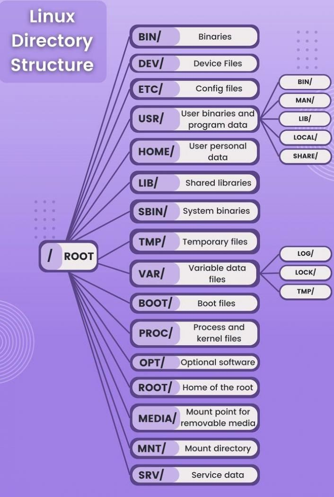
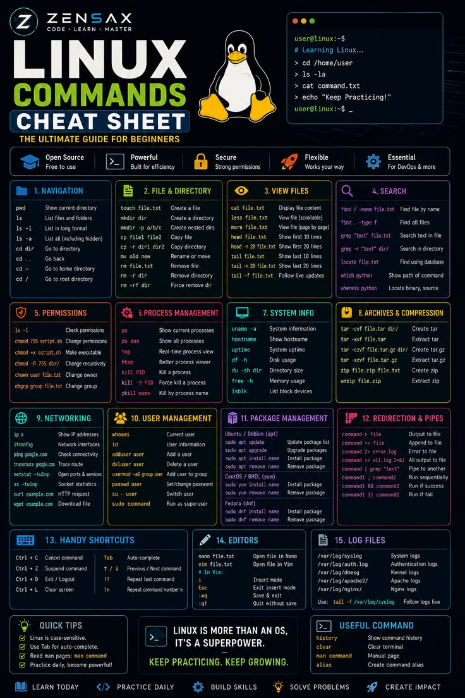

# Linux Learning Notes

## 1. Introduction to Linux

### What is Linux?

Linux is an open-source kernel originally created by Linus Torvalds in 1991.

The kernel is the core of an operating system. It manages communication between software and computer hardware, including the CPU, memory, storage, and devices.

A Linux distribution (distro) is an operating system built around the Linux kernel, together with system utilities, package managers, libraries, and other software.

### Examples of Linux distributions

- **Ubuntu** — beginner-friendly, desktop, server, and cloud computing.
- **Debian** — known for stability and widely used as a server operating system.
- **Kali Linux** — specialized for penetration testing and security auditing.
- **Parrot OS** — security, privacy, and development.
- **Fedora** — modern Linux technologies and development.
- **Arch Linux** — customizable distribution for users who want more control.

---

## 2. Linux vs Windows

| Feature | Linux | Windows |
|---|---|---|
| Filesystem structure | Starts from one root directory, `/` | Uses drive letters such as `C:` |
| Source code | Open-source kernel and many open-source components | Primarily proprietary |
| User interface | Command line and graphical interfaces | Command line and graphical interfaces |
| Shells | Bash, Zsh, Fish, and others | PowerShell, Command Prompt, and others |
| Software installation | Package managers such as `apt` | Installers, Microsoft Store, package managers |
| Customization | Highly customizable | Customizable, with different restrictions |
| Disk usage | Can be lightweight or resource-intensive, depending on the distribution | Depends on the Windows edition and installation |

> **Important:** Linux is not limited to the terminal, and Windows is not limited to a GUI. Both support graphical interfaces and command-line tools.

---

## 3. Linux Filesystem

Linux has a hierarchical filesystem that starts at the root directory, represented by `/`.

Unlike Windows, Linux does not normally organize its filesystem around separate drive letters.


### Important directories

| Directory | Purpose |
|---|---|
| `/` | Root of the entire filesystem hierarchy |
| `/home` | Home directories for ordinary users |
| `/root` | Home directory of the root administrator |
| `/bin` | Essential user commands; often linked to `/usr/bin` |
| `/sbin` | System administration commands; often linked to `/usr/sbin` |
| `/usr` | Many installed programs, libraries, documentation, and shared resources |
| `/etc` | System-wide configuration files |
| `/lib` | Essential shared libraries and kernel-related files; often linked to `/usr/lib` |
| `/var` | Variable data, including logs, caches, and application data |
| `/tmp` | Temporary files |
| `/dev` | Device files representing hardware and virtual devices |
| `/proc` | Virtual filesystem exposing process and kernel information |
| `/sys` | Virtual filesystem exposing devices and kernel information |
| `/boot` | Files needed to boot the system |
| `/media` | Common mount location for removable media |
| `/mnt` | Common temporary mount point for filesystems |
| `/opt` | Optional or third-party application software |




### Understanding paths

An **absolute path** starts from `/`.

Example:

```
/home/user/Documents/notes.md
```

A **relative path** starts from your current working directory.

Special path symbols:

- `/` — filesystem root.
- `~` — current user's home directory.
- `.` — current directory.
- `..` — parent directory.

Examples:

```bash
cd /
cd /home
cd ~
cd ..
cd -
```

`cd -` returns to the previous working directory.

---

## 4. Linux Terminal and Shell

A **terminal emulator** provides a text interface where you can enter commands.

A **shell** interprets commands and runs programs. Bash (Bourne Again SHell) is one common Linux shell.

### How a command is executed

A simplified flow is:

1. The user enters a command in the terminal.
2. The shell interprets the command and launches a program.
3. The program uses operating-system interfaces, such as system calls, when it needs kernel services.
4. The kernel manages hardware and system resources.
5. Results are returned to the terminal.

Example:

```bash
ls
```

The shell runs the `ls` program, which lists directory contents.

Check your shell:

```bash
echo "$SHELL"
```

Check the current directory:

```bash
pwd
```

---

## 5. Basic Linux Commands

### 5.1 Navigation commands

| Command | Purpose |
|---|---|
| `pwd` | Print the current working directory |
| `ls` | List directory contents |
| `ls -l` | Display detailed file information |
| `ls -a` | Include hidden files |
| `ls -lh` | Show file sizes in a human-readable format |
| `cd /path` | Change to a specified directory |
| `cd ..` | Move to the parent directory |
| `cd ~` | Move to the user's home directory |
| `cd /` | Move to the filesystem root |
| `cd -` | Return to the previous directory |
| `clear` | Clear the terminal display |
| `tree` | Display directories as a tree, if installed |

Examples:

```bash
pwd
ls -lah
cd ~/Documents
cd ..
```

### 5.2 File and directory management

| Command | Purpose |
|---|---|
| `touch file.txt` | Create an empty file if it doesn't exist |
| `mkdir notes` | Create a directory |
| `mkdir -p a/b/c` | Create nested directories |
| `cat file.txt` | Display file contents |
| `less file.txt` | Read a file page by page |
| `head file.txt` | Display the first 10 lines |
| `tail file.txt` | Display the last 10 lines |
| `tail -f app.log` | Follow new log entries |
| `cp source destination` | Copy a file |
| `cp -r source destination` | Copy a directory recursively |
| `mv source destination` | Move or rename files |
| `rm file.txt` | Delete a file |
| `rmdir empty_dir` | Remove an empty directory |
| `rm -r directory` | Remove a directory and its contents |
| `file file.txt` | Identify a file's type |
| `stat file.txt` | Display file metadata |

> **Caution:** `rm` normally deletes files without moving them to a graphical trash bin. Double-check paths before using recursive deletion.

### 5.3 Finding files and searching text

| Command | Purpose |
|---|---|
| `find . -name "*.py"` | Find Python files under the current directory |
| `find /home -type d` | Find directories under `/home` |
| `grep "error" app.log` | Search for text in a file |
| `grep -i "error" app.log` | Search without case sensitivity |
| `grep -r "TODO" .` | Search recursively through files |
| `which python` | Find a command's executable in `PATH` |
| `command -v python` | Identify how the shell resolves a command |

Examples:

```bash
find . -name "*.md"
grep -n "ERROR" app.log
```

---

## 6. Other Useful Commands

| Command | Purpose |
|---|---|
| `whoami` | Print the current effective username |
| `id` | Display user and group IDs |
| `hostname` | Display the system hostname |
| `uname -a` | Display kernel and system information |
| `date` | Display the current date and time |
| `uptime` | Show system uptime and load averages |
| `history` | Show command history |
| `man ls` | Open the manual for a command |
| `ls --help` | Show command help where supported |
| `echo "Hello"` | Print text |
| `sleep 5` | Wait for five seconds |
| `which curl` | Find the `curl` executable in `PATH` |
| `df -h` | Show filesystem disk usage |
| `du -sh directory` | Show the total size of a directory |
| `free -h` | Show memory usage |
| `who` | Show logged-in users |
| `env` | Display environment variables |

### Understanding `sudo`

`sudo` allows an authorized user to execute a command with elevated privileges.

Example:

```bash
sudo apt update
```

This runs `apt update` with administrative privileges.

Use `sudo` only when needed. It does not permanently turn your account into the root user.

---

## 7. User and Group Management

Linux supports multiple users and groups. Permissions can be assigned to control access to files, directories, and system resources.

### User commands

| Command | Purpose |
|---|---|
| `adduser username` | Create a user interactively on Ubuntu |
| `sudo useradd username` | Create a user using a lower-level utility |
| `sudo passwd username` | Set or change a user's password |
| `sudo usermod -aG group username` | Add a user to a supplementary group |
| `su - username` | Switch to another user |
| `sudo -i` | Open a root login shell |
| `sudo userdel username` | Delete a user account |
| `sudo userdel -r username` | Delete a user and attempt to remove their home directory |

### Group commands

| Command | Purpose |
|---|---|
| `groups` | Display the current user's groups |
| `groups username` | Display another user's groups |
| `id username` | Display a user's IDs and groups |
| `sudo groupadd developers` | Create a group |
| `sudo groupdel developers` | Delete a group |
| `sudo gpasswd -d username developers` | Remove a user from a group |

### Adding a user to a group

```bash
sudo usermod -aG developers username
```

- `usermod` modifies an existing account.
- `-a` means append.
- `-G` specifies supplementary groups.

> **Important:** Always include `-a` when adding a user to supplementary groups with `usermod -G`; otherwise, existing supplementary group memberships can be replaced.

The new group membership may require logging out and back in to take effect in your session.

---

## 8. Processes and Services

A **process** is a running instance of a program.

A **service** is a background system function, commonly managed by systemd on Ubuntu.

These are related concepts, but they are not interchangeable.

### 8.1 Process management

| Command | Purpose |
|---|---|
| `ps` | Show processes associated with the current terminal |
| `ps aux` | Show processes across the system |
| `top` | Monitor processes and resource usage live |
| `htop` | Interactive process monitor, if installed |
| `pgrep nginx` | Find process IDs by name |
| `kill PID` | Send the default termination signal to a process |
| `kill -9 PID` | Forcefully terminate a process |
| `pkill nginx` | Send a signal to processes matching a name |
| `free -h` | Inspect memory usage |

Example:

```bash
ps aux
pgrep -a python
```

Use `kill -9` only when a process does not respond to normal termination. It prevents the process from handling the signal or cleaning up normally.

### 8.2 Foreground and background jobs

| Command or shortcut | Purpose |
|---|---|
| `Ctrl + C` | Interrupt the foreground process |
| `Ctrl + Z` | Suspend the foreground job |
| `jobs` | List jobs started by the current shell |
| `bg` | Resume a suspended job in the background |
| `fg` | Bring a job to the foreground |
| `command &` | Start a command in the background |

Example:

```bash
sleep 100
```

Press `Ctrl + Z` to suspend it, then run:

```bash
jobs
bg
fg
```

Background jobs started this way are associated with the shell. Closing the terminal may affect them.

### 8.3 Service management with systemd

Ubuntu uses systemd to manage many system services.

| Command | Purpose |
|---|---|
| `systemctl status nginx` | Show service status |
| `sudo systemctl start nginx` | Start a service |
| `sudo systemctl stop nginx` | Stop a service |
| `sudo systemctl restart nginx` | Restart a service |
| `sudo systemctl reload nginx` | Ask a service to reload its configuration, if supported |
| `systemctl is-active nginx` | Check whether a service is active |
| `systemctl is-enabled nginx` | Check whether it is enabled at boot |
| `sudo systemctl enable nginx` | Enable automatic startup at boot |
| `sudo systemctl disable nginx` | Disable automatic startup at boot |
| `sudo systemctl enable --now nginx` | Enable and start a service |
| `systemctl list-units --type=service` | List loaded service units |
| `systemctl list-units --type=service --all` | List loaded services, including inactive ones |
| `systemctl list-unit-files --type=service` | List installed service unit files and their enablement states |
| `journalctl -u nginx` | Read logs for a service |
| `journalctl -u nginx -f` | Follow a service's logs live |

Replace `nginx` with the actual service name.

> **Remember:** `enable` controls automatic startup at boot; it does not necessarily start a service immediately. Use `start` or `enable --now` when appropriate.

---

## 9. Network Management

Linux provides tools to inspect network interfaces, addresses, routes, DNS, and connectivity.

### 9.1 Network commands

| Command | Purpose |
|---|---|
| `ip addr` | Display network interfaces and IP addresses |
| `ip link` | Display network interfaces and link state |
| `ip route` | Display routing table |
| `ip neigh` | Display the neighbor/ARP table |
| `hostname -I` | Display assigned IP addresses |
| `ping -c 4 8.8.8.8` | Test connectivity to an IP address |
| `getent hosts example.com` | Resolve a hostname using system name-resolution configuration |
| `resolvectl status` | Inspect DNS configuration on systems using systemd-resolved |
| `ss -tulpn` | Inspect listening TCP/UDP sockets and processes where permissions allow |
| `curl -I https://example.com` | Inspect HTTP response headers |
| `traceroute example.com` | Trace the network route, if installed |

Examples:

```bash
ip addr
ip route
ping -c 4 8.8.8.8
getent hosts example.com
ss -tulpn
```

### What about `ifconfig`?

`ifconfig` is an older networking utility. It may not be installed by default on modern Ubuntu systems.

Use `ip addr` and `ip link` for most modern networking tasks.

---

## 10. File Permissions and Ownership

Linux permissions control who can read, modify, or execute a file.

Three permission categories:

- `u` — owner (user).
- `g` — group.
- `o` — others.

Three basic permissions:

- `r` — read.
- `w` — write.
- `x` — execute.

### 10.1 Permission commands

| Command | Purpose |
|---|---|
| `ls -l` | View permissions and ownership |
| `chmod 755 script.sh` | Set owner permissions to `rwx`, group and others to `r-x` |
| `chmod 644 file.txt` | Set owner permissions to `rw-`, group and others to `r--` |
| `chmod u+x script.sh` | Add execute permission for the owner |
| `chmod -R 755 directory` | Recursively change permissions |
| `chown user file.txt` | Change file ownership |
| `sudo chown user:group file.txt` | Change owner and group |
| `umask` | Display the default permission mask |

### 10.2 Understanding numeric permissions

Permission values:

- Read (`r`) = 4
- Write (`w`) = 2
- Execute (`x`) = 1

Add the values together for each permission category.

For `755`:

- Owner: 4 + 2 + 1 = 7 (`rwx`)
- Group: 4 + 1 = 5 (`r-x`)
- Others: 4 + 1 = 5 (`r-x`)

For `644`:

- Owner: 4 + 2 = 6 (`rw-`)
- Group: 4 = 4 (`r--`)
- Others: 4 = 4 (`r--`)

> **Security tip:** Avoid applying broad permissions such as `777` just to fix an access problem. Diagnose ownership and the specific permission required instead.

---

## 11. Application and Package Management

Ubuntu and Debian use APT to manage software packages.

### Common APT commands

| Command | Purpose |
|---|---|
| `sudo apt update` | Refresh available package information |
| `sudo apt upgrade` | Upgrade installed packages where possible |
| `sudo apt install curl` | Install a package |
| `sudo apt remove curl` | Remove a package |
| `sudo apt purge package` | Remove a package and its system configuration files managed by the package |
| `sudo apt autoremove` | Remove automatically installed packages no longer needed |
| `apt search nginx` | Search package names and descriptions |
| `apt show nginx` | Show package details |
| `dpkg -l` | List installed packages |
| `dpkg -L package` | List files installed by a package |

Example: Install curl

```bash
sudo apt update
sudo apt install curl
curl --version
```

> **Important:** `apt update` refreshes package information; it does not upgrade the installed software by itself.

APT is commonly used on Debian-based distributions. Other distributions use different package managers, such as `dnf` on Fedora.

---

## 12. How to Use `curl`

`curl` is a command-line tool for transferring data to and from URLs. It supports HTTP, HTTPS, and other protocols.

It is particularly useful for backend development, REST APIs, debugging web servers, and testing deployments.

### 12.1 Check the version

```bash
curl --version
```

### 12.2 Make a GET request

```bash
curl https://example.com
```

This sends an HTTP GET request and prints the response body.

### 12.3 Display response headers

```bash
curl -I https://example.com
```

This sends a HEAD request and displays the response headers.

To display headers alongside the response body:

```bash
curl -i https://example.com
```

### 12.4 Send data to an API

Example JSON request:

```bash
curl -X POST http://127.0.0.1:5000/advice \
  -H "Content-Type: application/json" \
  -d '{"advice":"Keep learning"}'
```

Explanation:

- `-X POST` specifies the HTTP method.
- `-H` adds an HTTP header.
- `Content-Type: application/json` indicates that the request body is JSON.
- `-d` supplies the request data.

This example assumes your local Flask application accepts a POST request at `/advice` with an `advice` field. Adjust the URL and JSON to match your API.

### 12.5 Display the HTTP status code

```bash
curl -s -o /dev/null -w "%{http_code}\n" \
  https://example.com
```

This prints the HTTP status code, such as `200`, `404`, or `500`.

### 12.6 Follow redirects

```bash
curl -L https://example.com
```

`-L` tells curl to follow HTTP redirects.

### 12.7 Save a response to a file

```bash
curl -o page.html https://example.com
```

This saves the response body to `page.html`.

To save using the remote filename where available:

```bash
curl -O https://example.com/file.zip
```

### 12.8 Add a timeout

```bash
curl --connect-timeout 5 --max-time 20 \
  https://example.com
```

This limits the connection-establishment time to five seconds and the overall transfer time to twenty seconds.

### 12.9 Test a local Flask API

If your AdviceAPI runs on port `5000`, you can test its root endpoint:

```bash
curl -i http://127.0.0.1:5000/
```

Test an endpoint that returns advice:

```bash
curl -i http://127.0.0.1:5000/advice
```

The exact endpoint and supported methods depend on your application routes.

---

## 13. Input, Output, Redirection, and Pipes

These concepts are important for Linux administration and automation.

### Standard streams

- Standard input (`stdin`) — usually the keyboard.
- Standard output (`stdout`) — usually the terminal.
- Standard error (`stderr`) — usually the terminal for error messages.

### Redirection operators

| Operator | Purpose |
|---|---|
| `>` | Write output to a file, replacing its previous contents |
| `>>` | Append output to a file |
| `<` | Read input from a file |
| `2>` | Redirect standard error |
| `2>&1` | Redirect standard error to the current standard output destination |

Examples:

```bash
echo "Linux notes" > notes.txt
echo "More notes" >> notes.txt
ls /missing-directory 2> errors.txt
```

### Pipes

A pipe (`|`) sends the standard output of one command to another command's standard input.

```bash
ps aux | grep python
```

This searches the process listing for lines containing `python`.

Another example:

```bash
cat app.log | grep ERROR
```

A more direct version is:

```bash
grep ERROR app.log
```

Using pipes is powerful, but you do not always need an extra command.

---

## 14. Archives and Compression

| Command | Purpose |
|---|---|
| `tar -czf backup.tar.gz directory/` | Create a compressed archive |
| `tar -xzf backup.tar.gz` | Extract a gzip-compressed tar archive |
| `tar -tf backup.tar.gz` | List archive contents |
| `zip -r backup.zip directory/` | Create a ZIP archive, if installed |
| `unzip backup.zip` | Extract a ZIP archive, if installed |

Examples:

```bash
tar -czf project-backup.tar.gz myproject/
tar -tzf project-backup.tar.gz
```

Inspect an archive's contents before extracting unfamiliar files.

---

## 15. Disk and System Resource Monitoring

These commands are useful when diagnosing a slow system or a server running out of resources.

| Command | Purpose |
|---|---|
| `df -h` | Show filesystem space usage |
| `du -sh ~/myproject` | Show the total size of a directory |
| `lsblk` | List block devices and partitions |
| `free -h` | Display memory usage |
| `uptime` | Display uptime and load averages |
| `top` | Monitor processes and resource usage |
| `journalctl -p err -b` | Show error-priority journal entries from the current boot |
| `dmesg` | Display kernel ring-buffer messages, subject to system permissions |

Examples:

```bash
df -h
lsblk
free -h
journalctl -p err -b
```

> **Be careful** when working with partitions and disks. Commands that format, repartition, or overwrite devices can destroy data.

---

## 16. Useful Keyboard Shortcuts

| Shortcut | Purpose |
|---|---|
| `Ctrl + C` | Interrupt a foreground command |
| `Ctrl + Z` | Suspend a foreground job |
| `Ctrl + D` | Send end-of-input; may exit a shell when appropriate |
| `Ctrl + L` | Clear the terminal display |
| `Ctrl + A` | Move to the beginning of the command line in Bash |
| `Ctrl + E` | Move to the end of the command line in Bash |
| `Ctrl + R` | Search command history interactively |
| `Tab` | Complete commands, paths, and filenames where possible |
| `↑` / `↓` | Navigate command history |

---



---

## 17. Linux Learning and Practice

The best way to learn Linux is to practise commands in a safe environment and understand what each command does.

### Suggested exercises

1. Navigate the filesystem using `pwd`, `ls`, and `cd`.
2. Create a directory and files using `mkdir` and `touch`.
3. Copy, rename, move, and delete test files.
4. Search for files using `find` and search text using `grep`.
5. Inspect file permissions using `ls -l` and practise `chmod` on test files.
6. Create a test user and group in a suitable Linux environment.
7. Inspect running processes using `ps`, `top`, and `pgrep`.
8. Inspect network addresses and routes using `ip addr` and `ip route`.
9. Install a harmless utility using APT.
10. Use `curl` to test an HTTP endpoint.
11. Inspect system logs with `journalctl`.
12. Write a small Bash script that automates a repetitive task.

### Safety rules

- Understand a command before running it with `sudo`.
- Double-check paths before deleting or changing files.
- Avoid copying commands that format disks or modify partitions without understanding their effects.
- Practise potentially destructive commands in a virtual machine or disposable test environment.
- Read manual pages when you need to understand options:

```bash
man chmod
man curl
man systemctl
```

Linux skills become especially useful in DevOps when you combine command-line knowledge with Bash scripting, networking, Git, SSH, Docker, systemd, logs, and deployment workflows.

## 18. Useful links

- Linux Kernel Documentation: <https://docs.kernel.org/?utm_source=chatgpt.com>
- Command line cheatsheet: <https://ubuntu.com/server/docs/reference/cli-cheatsheet/>
- curl docs: <https://curl.se/docs/?utm_source=chatgpt.com>
